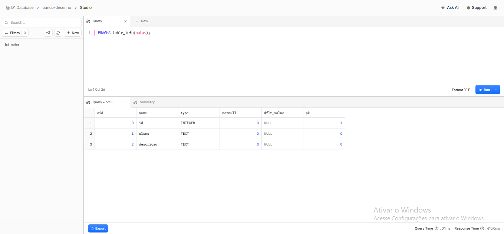

# Relatório de Avaliação - GitHub Actions

## Tarefa 1: CI a cada commit
- **Execução Verde (Sucesso):** https://github.com/joaooooszuni/desenho-assinado/actions/runs/38076612311/job/114284813454
- **Execução Vermelha (Falha):** https://github.com/joaooooszuni/desenho-assinado/actions/runs/38075867919/job/114282575883
- **Log do Erro:** 
  ```text
  Run for f in migrations/*.sql; do sqlite3 teste.db < "$f"; done
Parse error near line 1: near "tabela": syntax error
  CREATE tabela notas (id INTEGER PRIMARY KEY, aluno TEXT);
         ^--- error here
Error: Process completed with exit code 1.

## Tarefa 3: Revisão por IA no Pull Request

- **Dois Comentários da IA:**
  - **Comentário 1 (Alerta de Vulnerabilidade):** 
    > *"Revisão Automática de Segurança (IA): Análise concluída. Verifique pontos de SQL Injection (uso de prepare().bind()) e exposição de segredos no diff."*
  - **Comentário 2 (Após Correção - Synchronize):**
    > *"Revisão Automática de Segurança (IA): Análise concluída. Verifique pontos de SQL Injection (uso de prepare().bind()) e exposição de segredos no diff."*
  - **Link do PR com os comentários:** `https://github.com/joaooooszuni/desenho-assinado/pull/2`

- **Erro de Permissão Explicação (`pull-requests: write`):**
  Ao remover temporariamente a linha `pull-requests: write` do `.github/workflows/revisao-ia.yml`, a execução falhou ao tentar publicar o comentário com o erro:
  ```text
  GraphQL: Resource not accessible by integration (addComment)
  Error: Process completed with exit code 1.

  Crítica à IA :
A IA foi muito assertiva ao alertar sobre o risco de SQL Injection e indicar a utilização do método seguro .prepare().bind(). Contudo, o aviso genérico para "verificar exposição de segredos" foi irrelevante para este commit, uma vez que o código alterado continha apenas operações de consulta em banco de dados e nenhuma chave ou dado sensível exposto.


## Tarefa 4: Migração de Banco de Dados (Cloudflare D1)

Para validar a alteração de esquema no banco de dados SQLite remoto (`banco-desenho`) hospedado no Cloudflare D1, executámos a migração referente ao ficheiro `0002_adiciona_coluna.sql`, responsável por adicionar a coluna `descricao` na tabela `notas`.

Após a aplicação do script SQL, validámos a estrutura final da tabela através do comando `PRAGMA table_info(notas);` na consola do Cloudflare D1.

**Evidência da Estrutura Atualizada:**



Como pode ser observado na imagem acima, a coluna `descricao` do tipo `TEXT` foi adicionada com sucesso ao lado dos campos `id` e `aluno`.